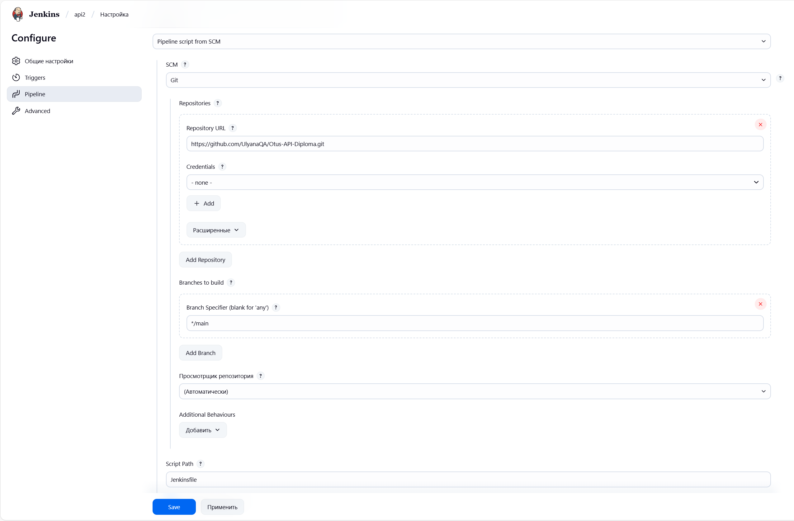
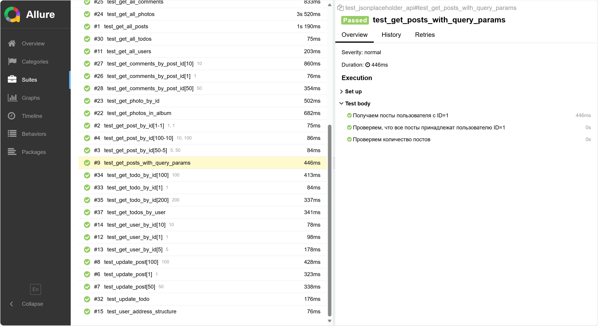

# Otus-API-Diploma

## Описание проекта

Тесты написаны с использованием pytest и allure-pytest для проверки API JSONPlaceholder .
Покрывают CRUD-операции для ресурсов: Posts, Comments, Albums, Photos, Users, Todos.

### Основные разделы тестов
**Posts**

1. Получение всех постов (GET).
2. Получение поста по ID (GET).
3. Создание (POST), обновление (PUT) и удаление (DELETE) поста.
4. Фильтрация постов по пользователю.

**Users**

1. Получение всех пользователей (GET).
2. Получение пользователя по ID (GET).
3. Проверка структуры данных (address).

**Albums**

1. Получение всех альбомов (GET).
2. Получение альбома по ID (GET).
3. Фильтрация альбомов по пользователю. 
4. Создание альбома (POST).

**Photos**

1. Получение фото из альбома (GET).
2. Получение фото по ID (GET). 
3. Получение всех фото (GET).

**Comments**

1. Получение всех комментариев (GET).
2. Получение комментариев по ID поста (GET).
3. Создание комментария (POST).

**Todos**

1. Получение всех задач (GET).
2. Создание (POST) и обновление (PUT) задачи. 
3. Получение задачи по ID (GET).
4. Удаление задачи по ID
5. Фильтрация задач по пользователю.

### Запуск тестов
Запуск тестов осуществляется с помощью Jenkinsfile

### Отчетность
Отчеты представлены в виде Allure
